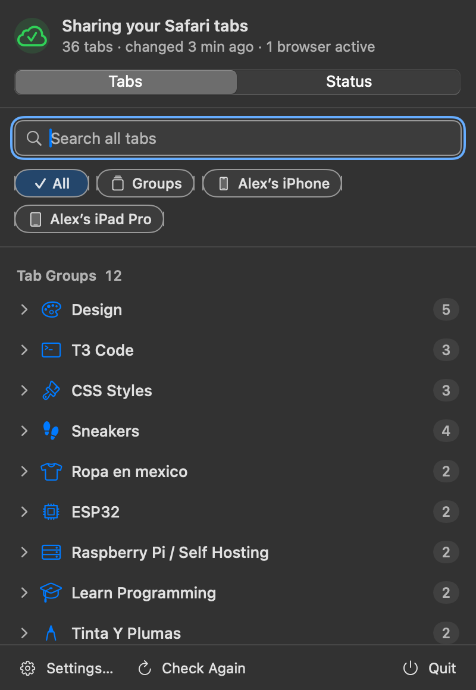
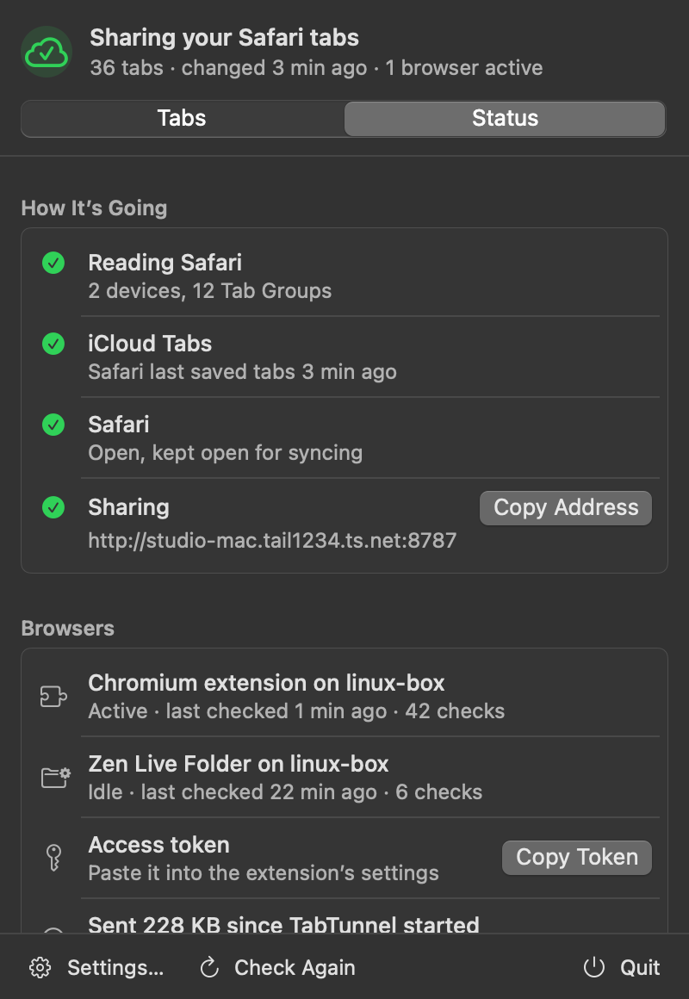
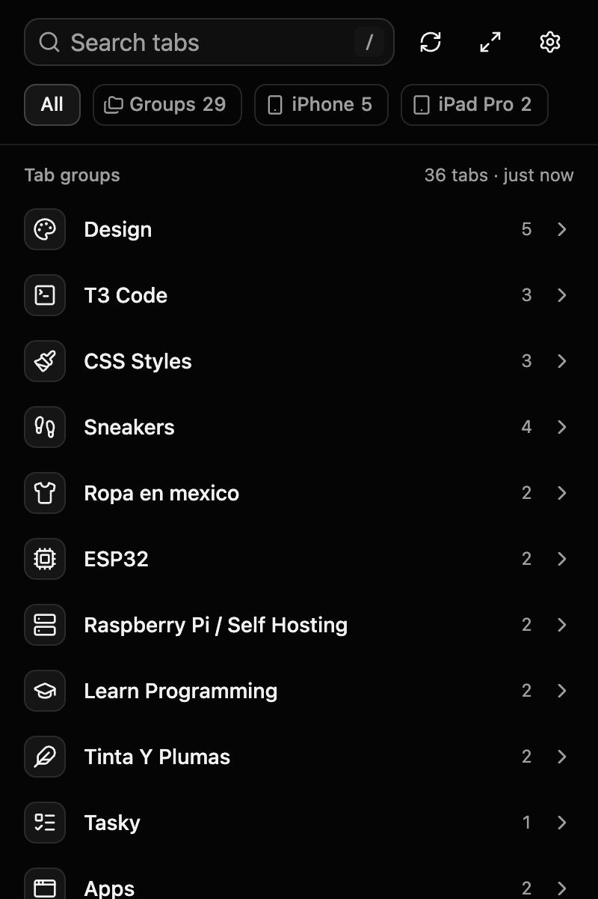

# TabTunnel

Shows your Safari tabs in the Mac's menu bar, and in Helium and Zen on Linux. That covers your Safari Tab Groups and the tabs open on your iPhone, iPad and Mac.

```
iPhone/iPad Safari --iCloud--> Mac Safari (CloudTabs.db, SafariTabs.db)
    --> TabTunnel.app (menu bar): browse tabs, open them in your default browser, see that sharing works
    --HTTP over Tailscale--> Helium: real tab groups that stay synced
                             Zen: Live Folders fed by RSS
```

> **TabTunnel depends on Safari's private files.** Apple doesn't offer a way for other apps to read iCloud Tabs or Tab Groups. TabTunnel reads Safari's own databases instead: `CloudTabs.db` and `SafariTabs.db` in `~/Library/Containers/com.apple.Safari/Data/Library/Safari/`, and the icon cache in `~/Library/Safari/Favicon Cache/`. Their location, tables and columns are undocumented and can change in any Safari or macOS update. If Apple moves or reshapes them, TabTunnel stops working until it's updated. It tells you when that happens ("Safari changed how it stores tabs") and keeps showing the last tabs it could read. All the schema knowledge is in `app/Sources/TabTunnelSafari/SafariData.swift`, so a fix touches one file.

<p>
  
  
  
</p>

You need macOS 14 or later on the Mac, and [Tailscale](https://tailscale.com) on the Mac and on the computers you want to see your tabs on.

## Download

Get the latest files from **[Releases](../../releases/latest)**:

| File | What it is |
|---|---|
| `TabTunnel-macOS.zip` | The Mac menu bar app (Apple silicon and Intel) |
| `TabTunnel-extension-chromium.zip` | The extension for Helium, Chrome and other Chromium browsers |
| `TabTunnel-extension-zen-firefox.xpi` | The signed extension for Zen and Firefox (only in releases built with Mozilla signing set up) |
| `TabTunnel-extension-firefox-unsigned.zip` | The unsigned Zen/Firefox extension, for temporary loading or signing yourself |

**Opening the Mac app the first time.** The release isn't notarized by Apple (that needs a paid Apple Developer account), so macOS blocks it at first. Unzip it, move `TabTunnel.app` to `/Applications`, then either:

- run `xattr -dr com.apple.quarantine /Applications/TabTunnel.app` in Terminal and open it, or
- open it once, then go to **System Settings › Privacy & Security** and click **Open Anyway**.

Every release is signed with the same TabTunnel certificate, so Full Disk Access survives updates: replace the app in `/Applications` and you're done.

## Mac: the TabTunnel app (`app/`)

TabTunnel is a native menu bar app (Swift, AppKit + SwiftUI). It's 4 MB on disk, uses about 15 MB of memory (the Reader about 5 MB), and does nothing while nothing changes: no polling, no timers that wake the CPU.

### Install

Download it (above), or build it yourself:

```
cd app && scripts/build.sh --install
```

This builds, signs and copies `TabTunnel.app` to `/Applications`, then opens it. Either way, the Setup Guide walks you through the rest and checks each step as you go:

1. **Allow access to Safari's tabs.** Give **TabTunnel Reader** Full Disk Access: click Open Full Disk Access, drag TabTunnel Reader from the Finder window into the list, and turn it on. macOS has no prompt for this. Only the Reader needs it; TabTunnel itself doesn't.
2. **Sync tabs with iCloud.** Safari must be on in iCloud settings on each device.
3. **Share with your other browsers** (optional). Copy the address and token into the extension.
4. **Open at login** (optional).

Signing: `build.sh` uses your "Apple Development" or "Developer ID Application" certificate (free from Xcode › Settings › Accounts), or `TABTUNNEL_SIGN_IDENTITY`. It refuses to sign ad hoc. macOS ties the Full Disk Access grant to the signature: with a certificate the grant survives rebuilds; ad-hoc builds lose it every time. The app and its Reader only talk to each other when both are signed by the same Apple team or, for self-signed builds like the releases, by the very same certificate.

Releases: pushing a `v*` tag runs `.github/workflows/release.yml`, which tests, builds a universal app with `app/scripts/release.sh`, builds the extensions and publishes them. It needs two repository secrets: `TABTUNNEL_P12` (a base64 `.p12` with a self-signed code-signing certificate named "TabTunnel Release Signing") and `TABTUNNEL_P12_PASSWORD`. Optional `AMO_JWT_ISSUER` and `AMO_JWT_SECRET` (Mozilla add-on API credentials) add a signed `.xpi` for Zen.

### Using it

Click the cloud in the menu bar.
- **Tabs** lists your Tab Groups (collapsed) and the tabs open on each device. Search covers every tab. The chips filter by Groups or by device. Click a tab to open it in your default browser; ⌘-click opens it in the background. Right-click for Copy Link, or for Open All on a group.
- **Status** says what works and what doesn't. Each problem comes with the button that fixes it.
- Keyboard: the search field has focus when the window opens. ↓ moves into the list, ↑/↓ move, Return opens, ⌘Return opens in the background, →/← expand and collapse, Esc clears the search and then closes. ⌘F search, ⌘1 Tabs, ⌘2 Status, ⌘, Settings.

Can't see the icon? A full menu bar can push it behind the notch. Open TabTunnel again from Finder or Spotlight and it opens in a window instead.

To use TabTunnel only as a status light, turn off **Settings › General › Show tabs in the menu bar**. Sharing keeps working.

The menu bar icon's shape tells you the state, so it doesn't rely on color:

| Icon | Meaning |
|---|---|
| cloud with a check | Working |
| cloud with an up arrow (for 1.5 s) | A browser just fetched your tabs |
| cloud with an exclamation mark | Needs attention: tabs still show, but something is off (Tailscale down, Safari closed, a firewall blocking browsers) |
| cloud with a slash | Not working (no Full Disk Access, Reader not running, Safari's format changed) |
| cloud with a circular arrow | Starting |

### When something's wrong

The Status page and the Setup Guide show these with a fix button. For reference:

| Message | What it means | Fix |
|---|---|---|
| Allow access to Safari's tabs | TabTunnel Reader has no Full Disk Access (new install, or the grant was removed) | Open Full Disk Access, add TabTunnel Reader, turn it on. Check Again. |
| TabTunnel Reader isn't running | The app can't reach its helper. It retries by itself | Check Again. If it persists, quit and reopen TabTunnel (it reinstalls the helper's launchd agent). |
| No iCloud Tabs on this Mac yet | `CloudTabs.db` doesn't exist | Turn on Safari in iCloud settings, open Safari once. |
| Safari changed how it stores tabs | The databases don't look like what TabTunnel knows | Update TabTunnel. Copy Diagnostics (no titles, URLs or secrets) for a bug report. |
| Tab Groups couldn't be read | `SafariTabs.db` failed to read; device tabs still work | Usually temporary. Check Again. |
| Safari is closed | iCloud only syncs while Safari runs | Open Safari, or turn on Keep Safari Open. |
| Tailscale isn't connected | No 100.x address on this Mac | Open Tailscale. TabTunnel rebinds by itself when it's back. |
| Port 8787 is already in use | Another program holds the port | Pick another port in Settings › Sharing (and in the extensions). |
| Browsers can't reach TabTunnel | TabTunnel is listening, but its own test connection got no answer: a firewall on the Mac (Little Snitch, a VPN filter) blocks it | Allow TabTunnel to accept incoming connections on the port, then Check Again. |
| TabTunnel can't use your keychain | The token couldn't be read from or saved to the login keychain | Unlock the login keychain in Keychain Access, then reopen TabTunnel. |

Logs: `~/Library/Logs/TabTunnel/Reader.log`, plus the unified log (`log show --predicate 'subsystem == "dev.tabtunnel"'`). Neither has tab titles, URLs or hostnames.

### How it works

- **TabTunnel Reader** (`Sources/TabTunnelReader`, inside `TabTunnel.app/Contents/Helpers/`) is the only part with Full Disk Access.
  - It copies Safari's databases (with their WAL) into a private folder, reads them into memory and deletes the copy at once. If Safari writes during the copy, it copies again.
  - It watches Safari's folder with FSEvents and re-reads only after Safari writes, at most once per 0.3–2 s burst. A cheap check every 60 s (two `stat` calls) covers missed events.
  - It hashes what you can see (titles, URLs, order, devices). Re-reading unchanged data never counts as a change.
  - It has no network code and runs no programs. It talks only to TabTunnel.app, over XPC. macOS checks on every connection that the caller is TabTunnel.app signed by the same Apple team.
  - launchd starts it when the app connects (agent `dev.tabtunnel.TabTunnel.Reader`). It exits a minute after the app quits.
- **TabTunnel.app** (`Sources/TabTunnel`, no Full Disk Access) has the menu bar UI and the HTTP server for the extensions (`Sources/TabTunnelNet`). It keeps Safari open hidden if you want, and follows Tailscale coming and going.
- The server listens only on this Mac's Tailscale address, port 8787. An address counts as Tailscale's only if it's in 100.64.0.0/10 on a tunnel interface that also has Tailscale's `fd7a:115c:a1e0::/48` IPv6 (or the Tailscale CLI lists it), so Cloudflare WARP, carrier NAT or a corporate VPN in the same range is never used. It's a plain BSD socket: Network.framework's `NWListener` never receives connections on a Tailscale (utun) address. When sharing starts, and on Check Again, the app requests its own `/health` over that address, so a firewall that blocks browsers shows up in Status. Its API:
  - `GET /tabs`: `{ updatedAt, devices: [...], tabGroups: [{ id, title, tabs: [{ id, title, url, pinned? }] }] }`, with an `ETag`. A request with `If-None-Match` gets `304 Not Modified` and no body when nothing changed.
  - `GET /favicon?url=<page>`: Safari's cached icon, otherwise (if allowed) fetched.
  - `GET /feeds/<group id>/link`: a Zen feed address for one group. `GET /feeds/<group id>.rss?key=...` serves that feed (with an ETag), and its key opens nothing else.
  - `GET /health`: `{"ok": bool}`, the only endpoint without a token. All others need `Authorization: Bearer <token>`.
- The token and feed secret live in your login keychain (service `dev.tabtunnel.TabTunnel`). Only TabTunnel can read them without a password prompt. Settings › Sharing copies the token (to this Mac's clipboard only, marked concealed, cleared after 60 s), makes a new one, or resets the feed links.

## Linux: extension (`webext/`)

The extension is built with React 19, TypeScript, Vite, Tailwind v4 and shadcn/ui (radix-nova style, lucide icons). It always uses a dark, near-black theme. There's one source tree and two manifests (`webext/manifests/`). Build it with `cd webext && npm install && npm run build`, which writes `dist/chromium`, `dist/firefox` and a zip of each. The Zen build leaves out the background worker.

- `src/popup/Popup.tsx`: the popup. It also opens as a full page via `popup.html?page`.
- `src/options/Options.tsx`: the settings page.
- `src/lib/icons.ts`: picks an icon for each group from its name (English and Spanish keywords). `node --experimental-strip-types scripts/test-icons.ts` tests the rules.
- `src/lib/groups.ts` and `src/background.ts`: mirror Safari groups into Helium tab groups.
- Favicons come from the relay's `/favicon`, which uses Safari's favicon cache first and otherwise fetches from the site on the Mac, then keeps a copy for 7 days. Dark favicons get a light tile.
- **Offline:** every successful load saves the full list (groups, devices, titles, URLs) and every tab's favicon (32px, refreshed weekly, pruned after 60 days unused) in extension storage. With the Mac off or asleep, the popup works from that copy and shows "Offline · last copy from …" with Retry. Helium groups stay as they are, and Zen Live Folders keep their tabs.
- **Filter by device:** a chip row under the search box (**All · Groups · one chip per device**) shows one device's open tabs, or only tab groups. The choice is remembered. Safari Tab Groups are shared across all your devices and Safari doesn't record which device a group tab is open on, so groups have their own chip. Search always covers every tab.

**Setup in either browser**: in TabTunnel on the Mac, open Status (or Settings › Sharing) and use **Copy Address** and **Copy Token**. In the extension's Settings, paste both, press Save and test, then allow access to that address when the browser asks. Alt+Shift+T opens the popup.

The popup shows **Safari tab groups** first, collapsed, and below them **Open on devices**. Click a tab to open it; Ctrl-click or middle-click opens it in the background.

### Helium: tab groups

To install, unzip `TabTunnel-extension-chromium.zip` from [Releases](../../releases/latest) (or `webext/dist/icloud-tabs-relay-chromium.zip` from your own build) into a folder you'll keep. Then open `chrome://extensions`, turn on Developer mode and choose Load unpacked.

Hover or focus a group and press **Open as group** (folder icon). It opens the Safari group as a Helium tab group with the same name and a stable color. A background job keeps it in sync every 2 minutes, and also whenever you open the popup. Each check sends the last version it has (`If-None-Match`); when nothing changed, the Mac answers `304 Not Modified` with no body, so checks cost a few hundred bytes. Sync only goes from Safari to Helium:
- When you add a tab in Safari, it's added to the Helium group.
- When you remove a tab in Safari, Helium closes it, but only if the extension opened it.
- If you rename the group in Safari, the Helium group is renamed too.
- Tabs you add in Helium stay. Tabs you close in Helium don't come back.
- Closing the whole group in Helium unlinks it. Press **Open as group** again to bring it back.
- **Show group** focuses an existing linked group.

### Zen: folders (Live Folders)

Zen's folders can't be created by extensions: `tabs.group` makes a plain Firefox tab group, and Zen turns those off. Instead, the relay serves each Safari group as an RSS feed, and Zen's **Live Folders** turn a feed into a real folder that keeps itself updated.

1. In the popup, hover a group and click its RSS button to copy the feed address.
2. In Zen, create a new Live Folder, choose RSS, and paste the address.
3. In the folder's menu, set the item limit to 50 (the default is 10) and pick a refresh interval.

Notes: tabs you navigate away from in Safari are replaced by the new page. Zen allows at most 50 items per Live Folder, so a group with more tabs than that shows only its first 50. **Open all** opens a group's tabs without a folder.

To install in Zen, you need a signed build, because Zen removes unsigned extensions when it restarts. If the release has `TabTunnel-extension-zen-firefox.xpi`, open that in Zen. Otherwise sign it yourself:
1. Create API credentials at https://addons.mozilla.org/developers/addon/api/key/
2. Run `npx web-ext sign -s dist/firefox --channel unlisted --api-key ... --api-secret ...`
3. Open the resulting `.xpi` in Zen.

For a quick test, use `about:debugging#/runtime/this-firefox` > Load Temporary Add-on. The Live Folders keep working without the extension; it only copies feed addresses.

## Security

What the app does:

- **Full Disk Access stays in the Reader**, which reads Safari's live databases read-only straight into memory (no copies on disk; copying to a private temp folder is only a fallback, swept at startup). It reads nothing until a verified TabTunnel.app has connected. It has no network code (it doesn't link the networking module), runs no other programs, takes no paths or queries, and only answers TabTunnel.app signed by the same Apple team (or, for release builds, the same certificate). Icons from Safari's cache leave it as raw bytes and are decoded in the app, so the process with Full Disk Access never parses images. It only returns icons for pages in your current tab list.
- **The token is never in a URL, the environment, a plist or a log.** It's in the login keychain, readable without a prompt only by TabTunnel; the extension sends it only in an `Authorization` header. Comparisons are constant-time. Copying it puts it on this Mac's clipboard only (not Universal Clipboard), for 60 s.
- **Zen feeds get per-group keys** (HMAC of the feed secret and the group id). A key opens only its own group's RSS. Reset Feed Links revokes all of them.
- **Web pages can't read the relay.** No CORS headers. The `Host` header must name the relay, which blocks DNS rebinding. `/health` says only `{"ok": bool}`. A `304` is only sent after the token checks out.
- **The server is small and strict.** GET only, HTTP/1.0, one request per connection, 16 KB of headers, 10 s per connection, 32 connections at once, no request bodies, no chunked requests. It listens only on the verified Tailscale address and never falls back to other interfaces. Turning sharing off closes open connections too.
- **Icon fetching is off by default and fenced in.** Safari's cache comes first and needs no network. If you turn on "Look up missing icons on the web", TabTunnel asks the site for its home page and icon files, never the page you had open, then DuckDuckGo or Google with only the domain. Every connection and redirect hop goes only to a public address: it connects to the checked IP itself so DNS can't be swapped, with no localhost, LAN, tailnet, link-local or metadata addresses, and with timeouts and size caps. Results stay in memory.
- **Safari data isn't left on disk.** Copies live only as long as SQLite needs to read them, in a fresh 0700 folder.
- **Extension:** opens only http(s) URLs from synced data, accepts messages only from its own pages, re-encodes icons before storing them, and clears its saved copy when the relay or token changes.

Still possible: a program already running as you can ask for the keychain item (you'd see a password prompt naming it), read the clipboard during the 60 s after you copy the token, or watch the HTTP traffic on your tailnet (it's plain HTTP inside Tailscale's encrypted tunnel). It can't use the Reader's Full Disk Access.

## Limits

- Sync only goes one way, from Apple devices to the Mac menu bar and Linux.
- iCloud only brings other devices' tabs to the Mac while Safari is running. TabTunnel can keep Safari open hidden (on by default).
- If the Mac is asleep, Helium keeps its groups as they are and the popup shows the last copy it got.
- Tab group order: Safari stores many groups with the same `order_index`, so their order may not match Safari's sidebar exactly.
- Safari's databases are private and can change in any update (see the note at the top).
- Full Disk Access has no prompt; it has to be added in System Settings. With a certificate-signed build the grant survives rebuilds; it's lost if you sign with a different certificate.

## Tests

- `cd app && swift test`: 38 tests. Parsing the fixtures, change detection and stable revisions, schema-change and missing-database reporting, the HTTP parser's limits, the router (Host check, auth, ETag/304 after auth, stale data, feeds and feed keys matching Python's HMAC, RSS escaping), the public-address fence and favicon link parsing, the FSEvents watcher on a real write, and regressions from the reviews: 45 connections in a row (an `NWListener` allowance once stopped the server at 32), serving on the real Tailscale address, overflowing chunk sizes, the favicon deadline, distinct stale ETags, and reading Safari's database without a temp copy.
- `app/.build/debug/TabTunnel --gallery app/Tests/Fixtures/demo.json <dir>` (debug builds only): renders every UI state to PNG for design review.
- `tools/e2e_groups.mjs`: tests Helium tab-group mirroring end to end in a throwaway headless Helium. Point it at `app/.build/debug/tabtunnel-dev serve <fixture dir> <port> <token>`, which serves fixture databases with the app's server.
- `tools/shots.mjs`: captures the extension's UI states. Run `python3 tools/make_demo.py` first.
